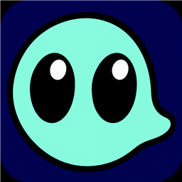

  

<h1 align="center">Nocta</h1>

  <b>여러 AI를 한 화면에서. 녹시들이 계속 일합니다.</b> 
  Many AIs, one screen. Noxies keep working.

  
  
  

  

## 받기

**[최신 설치 파일 받기 (Windows)](https://github.com/karnelian/nocta-releases/releases/latest)** — `Nocta-x.y.z-setup.exe` 를 받아 실행하세요. 한 번 설치하면 앱이 알아서 업데이트해요.

AgentManager 를 쓰고 있었다면 앱에서 업데이트하세요. "Nocta 로 옮겨 가세요" 안내의 **[Nocta 설치]** 한 번으로 프로젝트 · 대화 · 칸 · 계정을 그대로 복사해 와요.

## Nocta 는

Claude Code · Codex · Grok · Gemini CLI 를 프로젝트별 **칸**으로 나눠 돌리는 Windows 데스크톱 앱이에요. 칸 하나에 녹시 한 마리가 붙어 일해요.

  

| | |
|---|---|
| 🌙 **칸 나눠서 맡기기** | 메인 칸이 칸마다 할 일을 나누고, [이대로 시작] 한 번이면 칸들이 알아서 일해요. 다 끝나면 메인 칸이 받아서 다시 나누거나 정리해요 |
| 📝 **아침 보고서** | 끝낼 시각에 맞춰 HTML 보고서와 그림으로 정리하고 폰으로 알려요 |
| 🔁 **알아서 자동 진행** | 목표를 주면 끝까지 턴을 이어 가요. 구독 한도에 걸리면 기다렸다 이어 가요 |
| 🪟 **카드 창 · 끌어서 배치** | 창 머리줄을 잡고 끌면 새 자리로 미끄러져 앉아요 |
| 📊 **사용량 막대** | Claude · Codex · Grok 구독 사용량과 초기화까지 남은 시간 |
| 📱 **폰으로 이어 보기** | 일이 끝나면 폰 알림, 누르면 그 칸 대화로 바로 |

자세한 사용법은 **[문서](https://nocta.karnellabs.com/docs/)** 에 있어요.

## 필요한 것

- Windows 10 이상
- AI CLI 하나 이상 — Claude Code(`npm install -g @anthropic-ai/claude-code`) · Codex · Grok · Gemini
- 쓰려는 AI 의 구독이나 키

---

이 저장소는 설치 파일과 자동 업데이트용 파일을 올리는 곳이에요. 버그나 제안은 이 저장소 Issues 로 알려 주세요.
